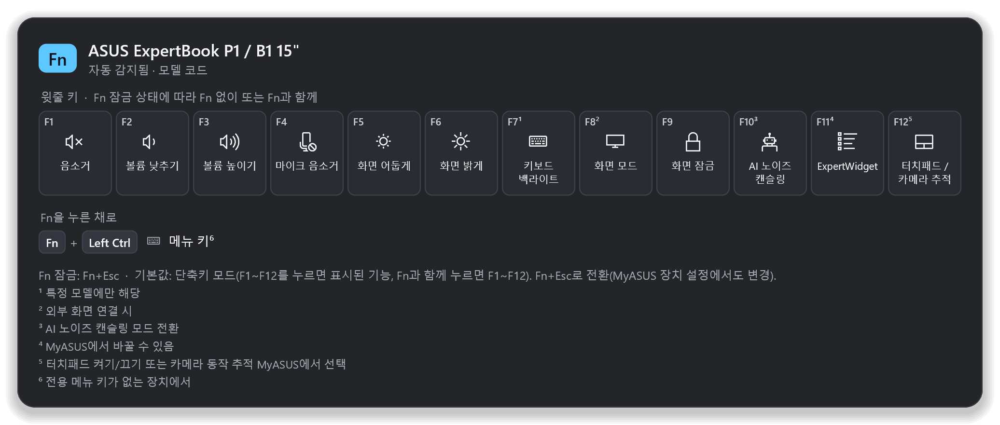
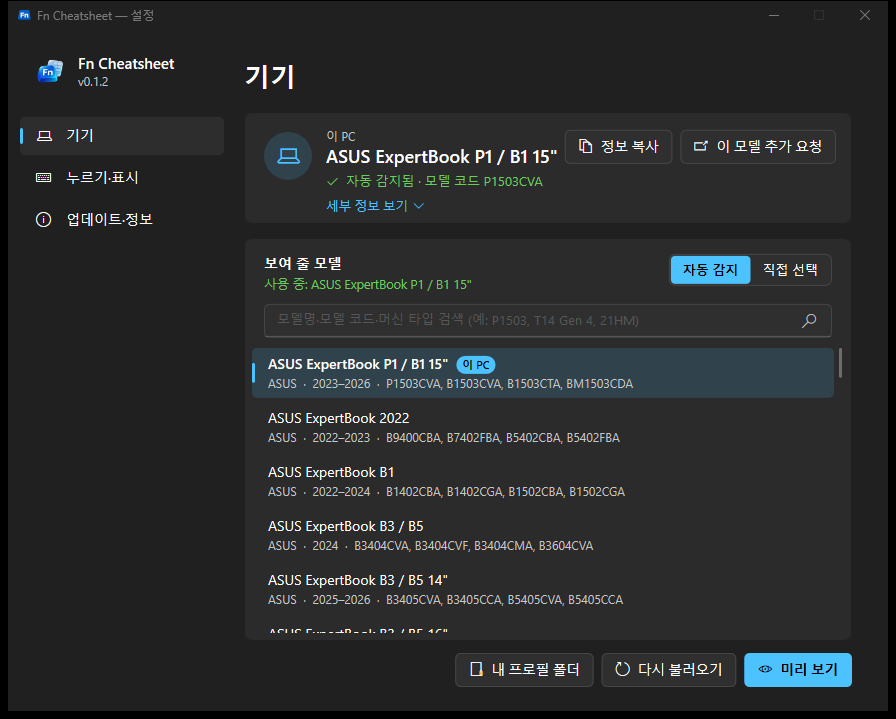
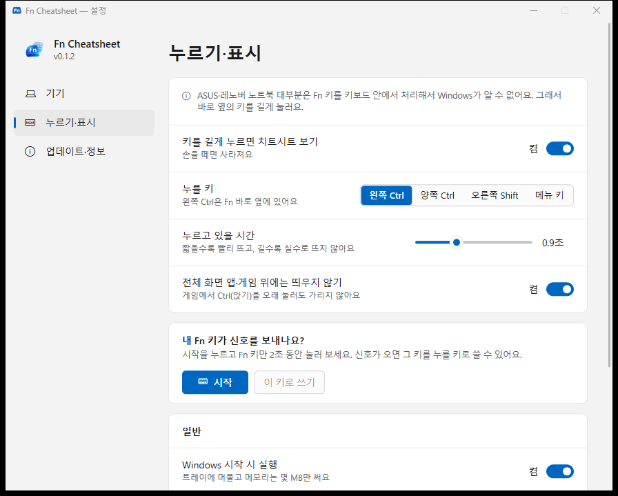

<div align="center">


# Fn Cheatsheet

**노트북 Fn 키, 이제 외우지 마세요.**<br/>
왼쪽 <kbd>Ctrl</kbd>을 길게 누르면 **내 노트북 모델**의 Fn 키 기능이 화면에 떠요. 손을 떼면 사라져요.

[](https://github.com/jeiel85/cheatsheet-win/releases/latest)
[](https://github.com/jeiel85/cheatsheet-win/actions/workflows/build.yml)
[](#-설치)
[](#-faq)
[](LICENSE)

[**⬇ 다운로드**](https://github.com/jeiel85/cheatsheet-win/releases/latest/download/FnCheatsheet.exe) &nbsp;·&nbsp;
[**🌐 소개 페이지 · 지원 모델 검색**](https://jeiel85.github.io/cheatsheet-win/) &nbsp;·&nbsp;
[**English**](README.en.md)



</div>

---

## 🤔 왜 만들었나요?

ASUS 노트북과 Lenovo 노트북을 같이 쓰면 **Fn 키 배치가 모델마다 달라서** 매번 헷갈려요.
키캡의 작은 아이콘만으로는 알기 어렵고, 설명서는 PDF 수십 쪽 속에 숨어 있죠.
맥에는 <kbd>⌘</kbd>을 길게 누르면 단축키를 보여 주는 CheatSheet가 있는데, Windows 노트북에는 없어서 만들었어요.

## ✨ 기능

| | 기능 | 설명 |
|:-:|---|---|
| 🔍 | **모델 자동 확인** | Windows에 기록된 제조사·모델 코드(ASUS `P1503CVA`, Lenovo 머신 타입 `21HM` 등)로 맞는 키보드 프로필을 찾아요. |
| 🙅 | **추측하지 않기** | 목록에 없거나 후보가 여럿이면 엉뚱한 표 대신 "모델을 골라 주세요"라고 안내해요. 제조사만 같다고 아무 프로필이나 쓰지 않아요. |
| ⌨️ | **길게 누르기 · 두 번 누르기** | 왼쪽 <kbd>Ctrl</kbd>만 0.9초 누르고 있거나, <kbd>Ctrl</kbd>을 빠르게 두 번 누르면 떠요(설정에서 선택). 다른 키·클릭·스크롤이 섞이면 뜨지 않아서 <kbd>Ctrl</kbd>+<kbd>C</kbd>, <kbd>Ctrl</kbd>+클릭은 그대로예요. |
| 📖 | **공식 설명서 기반** | 모든 키 정보는 ASUS E-Manual, Lenovo User Guide 등 제조사 문서에서 가져왔고, 설정 → 정보에서 출처 링크를 볼 수 있어요. |
| 🧩 | **직접 고르기·추가** | 설정에서 모델을 고르거나, `%APPDATA%\FnCheatsheet\profiles\`에 JSON 파일을 넣어 내 프로필을 추가할 수 있어요. |
| 🌗 | **한국어·영어, 다크·라이트** | Windows 언어와 테마를 따라가고, 멀티 모니터·고해상도(DPI)에서도 작업 중인 화면 가운데에 떠요. |
| 🪶 | **아주 가벼움** | Rust + Win32로 만든 2 MB짜리 exe 하나예요. 런타임 설치가 필요 없고, 트레이에 상주할 때 메모리를 몇 MB만 써요. |
| 🔄 | **자동 업데이트** | 하루 한 번 GitHub 릴리스를 확인해서, 새 버전이 있으면 SHA-256을 검증한 뒤 스스로 교체하고 다시 시작해요. 설정에서 끌 수 있어요. |

<p align="center">
  
  
</p>

## 🤷 왜 Fn이 아니라 Ctrl인가요?

ASUS·Lenovo 노트북 대부분은 Fn 키를 **키보드 컨트롤러(EC) 안에서 처리**해요.
Fn만 누르면 Windows에 **아무 신호도 오지 않아서**, 어떤 앱도 Fn을 누르고 있는지 알 수 없어요.

- 그래서 기본 트리거는 Fn **바로 옆의 왼쪽 Ctrl**이에요.
- ThinkPad는 BIOS 또는 Lenovo Vantage에서 **Fn↔Ctrl 위치를 바꿀 수** 있어요.
- Fn이 신호를 보내는 모델이라면 **설정 → 누르기·표시 → 직접 등록**에서 Fn 자체를 트리거로 쓸 수 있어요. 신호가 오는지도 거기서 바로 확인돼요.
- 트레이 아이콘을 클릭해도 언제든 볼 수 있어요.

### 🔬 내 노트북의 Fn은 정말 신호가 없을까? — FnProbe

[**FnProbe.exe**](https://github.com/jeiel85/cheatsheet-win/releases/latest/download/FnProbe.exe)는 Fn만 눌렀을 때 Windows가 볼 수 있는 **모든 경로**를 한 번에 확인하는 진단 도구예요. 아무것도 바꾸지 않고 읽기만 해요.

- 키보드 후킹(스캔 코드), 모든 HID 장치의 원시 입력(제조사 전용 페이지 포함), 제조사 WMI 이벤트(ASUS ATK, Lenovo, ThinkPad…)
- ASUS: ACPI 장치 상태값 수천 개를 Fn을 누를 때와 뗄 때 비교(DSTS, 읽기 전용). 팬 속도처럼 저절로 바뀌는 값은 걸러요
- 안내대로 Fn을 눌러 보면 바탕화면에 보고서가 저장돼요. 신호가 잡히면 이슈로 보내 주세요 — 그 모델은 **Fn 자체로** 띄울 수 있게 만들게요

노트북 앞에서 직접 실행하세요. 원격 데스크톱에서는 Fn이 원격 PC로 전달되지 않아요.

## 💻 지원 모델

전체 목록과 모델별 키 배치는 **[소개 페이지](https://jeiel85.github.io/cheatsheet-win/#models)** 에서 검색할 수 있어요.
PowerShell 결과를 붙여 넣으면 내 노트북이 자동으로 인식되는지도 확인해 줘요.

<!-- models:start -->
**130개 프로필** (ASUS 36 · Lenovo 94) · 데이터 2026.11.13 · ✅ 공식 설명서로 전체 확인 🟡 일부 확인

| 제조사 | 모델 | 연식 | 자동 인식 기준 | 확인 |
|---|---|---|---|:-:|
| ASUS | [ASUS ExpertBook 2022 (B9400CBA, B7402FBA, B5402CBA/FBA, B5602CBA/FBA, B5302CBA/FBA, B3402FBA/FVA, B2402/B2502 CBA/FBA, B1400/B1500CBA)](https://jeiel85.github.io/cheatsheet-win/#m-asus-expertbook-2022) | 2022–2023 | B9400CBA, B7402FBA, B5402CBA, B5402FBA, B5602CBA, B5602FBA, B5602CBN, B5602FBN, B5302CB… | ✅ |
| ASUS | [ASUS ExpertBook B1 (B1402CBA/CGA, B1502CBA/CGA, B1402CVA, B1502CVA, B1408CVA, B1508CVA)](https://jeiel85.github.io/cheatsheet-win/#m-asus-expertbook-b1-2022-2023) | 2022–2024 | B1402CBA, B1402CGA, B1502CBA, B1502CGA, B1402CVA, B1502CVA, B1408CVA, B1508CVA | ✅ |
| ASUS | [ASUS ExpertBook B3 / B5 (B3404, B3604, B5404, B5604 CVA/CVF/CMA)](https://jeiel85.github.io/cheatsheet-win/#m-asus-expertbook-b3-b5-2024) | 2024 | B3404CVA, B3404CVF, B3404CMA, B3604CVA, B3604CVF, B3604CMA, B5404CVA, B5404CVF, B5404CM… | ✅ |
| ASUS | [ASUS ExpertBook B3 / B5 14" (B3405CVA/CCA, B5405CVA/CCA)](https://jeiel85.github.io/cheatsheet-win/#m-asus-expertbook-b3-b5-14-2025) | 2025–2026 | B3405CVA, B3405CCA, B5405CVA, B5405CCA | ✅ |
| ASUS | [ASUS ExpertBook B3 / B5 16" (B3605CVA/CCA, B5605CVA/CCA)](https://jeiel85.github.io/cheatsheet-win/#m-asus-expertbook-b3-b5-16-2025) | 2025–2026 | B3605CVA, B3605CCA, B5605CVA, B5605CCA | ✅ |
| ASUS | [ASUS ExpertBook B3 / P3 / P5 14" (B3406CCA, P3406CCA, P5406CCA)](https://jeiel85.github.io/cheatsheet-win/#m-asus-expertbook-14-2026) | 2026 | B3406CCA, P3406CCA, P5406CCA | ✅ |
| ASUS | [ASUS ExpertBook B3 / P3 / P5 16" (B3606CCA, P3606CCA, P5606CCA)](https://jeiel85.github.io/cheatsheet-win/#m-asus-expertbook-16-2026) | 2026 | B3606CCA, P3606CCA, P5606CCA | ✅ |
| ASUS | [ASUS ExpertBook B9 (B9406CAA)](https://jeiel85.github.io/cheatsheet-win/#m-asus-expertbook-b9-2025) | 2025–2026 | B9406CAA | ✅ |
| ASUS | [ASUS ExpertBook B9/B7/B5/B2 2023 (B9403CVA, B9403CVAR, B7402FVA, B5402CVA/FVA, B5602CVA/CVN, B2402/B2502 CVA/FVA)](https://jeiel85.github.io/cheatsheet-win/#m-asus-expertbook-2023) | 2023–2024 | B9403CVA, B7402FVA, B5402CVA, B5402FVA, B5602CVA, B5602CVN, B2402CVA, B2502CVA, B2402FV… | ✅ |
| ASUS | [ASUS ExpertBook P1 / B1 14" (P1403CVA, B1403CVA, B1403CTA, BM1403CDA, PM1403CDA)](https://jeiel85.github.io/cheatsheet-win/#m-asus-expertbook-b1-p1-14-2024) | 2023–2026 | P1403CVA, B1403CVA, B1403CTA, BM1403CDA, PM1403CDA | ✅ |
| ASUS | [ASUS ExpertBook P1 / B1 15" (P1503CVA, B1503CVA, B1503CTA, BM1503CDA, PM1503CDA)](https://jeiel85.github.io/cheatsheet-win/#m-asus-expertbook-b1-p1-15-2024) | 2023–2026 | P1503CVA, B1503CVA, B1503CTA, BM1503CDA, PM1503CDA | ✅ |
| ASUS | [ASUS ExpertBook P3 14" (P3405CVA)](https://jeiel85.github.io/cheatsheet-win/#m-asus-expertbook-p3-14-2025) | 2025 | P3405CVA | ✅ |
| ASUS | [ASUS ExpertBook P3 14" AMD (PM3406CKA)](https://jeiel85.github.io/cheatsheet-win/#m-asus-expertbook-pm3-14-2025) | 2025–2026 | PM3406CKA | ✅ |
| ASUS | [ASUS ExpertBook P3 16" (P3605CVA)](https://jeiel85.github.io/cheatsheet-win/#m-asus-expertbook-p3-16-2025) | 2025 | P3605CVA | ✅ |
| ASUS | [ASUS ExpertBook P3 16" AMD (PM3606CKA)](https://jeiel85.github.io/cheatsheet-win/#m-asus-expertbook-pm3-16-2025) | 2025–2026 | PM3606CKA | ✅ |
| ASUS | [ASUS ExpertBook P5 (P5405CSA)](https://jeiel85.github.io/cheatsheet-win/#m-asus-expertbook-p5-2024) | 2024–2025 | P5405CSA | ✅ |
| ASUS | [ASUS ROG Flow Z13 (GZ302EA)](https://jeiel85.github.io/cheatsheet-win/#m-asus-rog-flow-z13-2025) | 2025 | GZ302E | ✅ |
| ASUS | [ASUS ROG Zephyrus G14 2024 (GA403U), Zephyrus G16 2024 (GU605M), Strix G16 2023 (G614J)](https://jeiel85.github.io/cheatsheet-win/#m-asus-rog-2023-2024) | 2023–2024 | GA403U, GU605M, G614J | ✅ |
| ASUS | [ASUS ROG Zephyrus G14 2025 (GA403W), Zephyrus G16 2025 (GU605C), Strix G16 2025 (G615L/J)](https://jeiel85.github.io/cheatsheet-win/#m-asus-rog-2025) | 2025 | GA403W, GU605C, G615L, G615J | ✅ |
| ASUS | [ASUS TUF Gaming A14 (FA401W/U), A16 (FA608W), F16 (FX608L/J)](https://jeiel85.github.io/cheatsheet-win/#m-asus-tuf-2024-2025) | 2024–2025 | FA401W, FA401U, FA608W, FX608L, FX608J | ✅ |
| ASUS | [ASUS TUF Gaming A15/A17 (FA507N/X, FA707N/X), F15/F17 (FX507V, FX707V) 2023](https://jeiel85.github.io/cheatsheet-win/#m-asus-tuf-2023) | 2023 | FA507N, FA507X, FA707N, FA707X, FX507V, FX707V | ✅ |
| ASUS | [ASUS Vivobook 14/15/16/17 (X1404/X1504/X1704 VA/ZA, X1405VA/X1505VA/X1605VA, M1405/M1505/M1605YA, X1404/X1504/X1704MA)](https://jeiel85.github.io/cheatsheet-win/#m-asus-vivobook-14-15-16-2023) | 2023–2026 | X1404VA, X1404ZA, X1504VA, X1504ZA, X1704VA, X1704ZA, X1405VA, X1505VA, X1605VA, M1405Y… | ✅ |
| ASUS | [ASUS Vivobook 14/15/16/17 2022 (X1502ZA, X1503ZA, X1603ZA, X1702ZA, M1503QA, M1603QA, M1702QA, X1405ZA, X1505ZA, X1605ZA)](https://jeiel85.github.io/cheatsheet-win/#m-asus-vivobook-15-16-2022) | 2022–2023 | X1502ZA, X1503ZA, X1603ZA, X1702ZA, M1503QA, M1603QA, M1702QA, X1405ZA, X1505ZA, X1605ZA | ✅ |
| ASUS | [ASUS Vivobook 14/16 2025 (X1407CA, X1607CA, X1407QA, X1607QA, M1407KA, M1607KA)](https://jeiel85.github.io/cheatsheet-win/#m-asus-vivobook-14-16-2025) | 2025–2026 | X1407CA, X1607CA, X1407QA, X1607QA, M1407KA, M1607KA | ✅ |
| ASUS | [ASUS Vivobook 15X/16X/17X (K3504, K3604, K3704, K3605)](https://jeiel85.github.io/cheatsheet-win/#m-asus-vivobook-x-2023) | 2023–2024 | K3504VA, K3504ZA, K3604VA, K3604ZA, K3704VA, K3605VC, K3605VU, K3605VV, K3605ZC, K3605Z… | ✅ |
| ASUS | [ASUS Vivobook Go 14 (E1404FA/GA), Go 15 (E1504FA/GA)](https://jeiel85.github.io/cheatsheet-win/#m-asus-vivobook-go-14-15) | 2023–2025 | E1404FA, E1404GA, E1504FA, E1504GA | ✅ |
| ASUS | [ASUS Vivobook Pro 15 OLED (N6506MV, N6506MU, N6506MJ)](https://jeiel85.github.io/cheatsheet-win/#m-asus-vivobook-pro-15-2024) | 2024 | N6506MV, N6506MU, N6506MJ, N6506MI | ✅ |
| ASUS | [ASUS Vivobook S 14 / S 15 OLED (K5404VA, K5504VA)](https://jeiel85.github.io/cheatsheet-win/#m-asus-vivobook-s-14-15-2023) | 2023 | K5404VA, K5504VA | ✅ |
| ASUS | [ASUS Vivobook S 14 / S 16 2025 (S3407CA/QA, S3607CA/QA, M3407HA/KA, M3607HA/KA)](https://jeiel85.github.io/cheatsheet-win/#m-asus-vivobook-s-14-16-2025) | 2025 | S3407CA, S3407QA, S3607CA, S3607QA, M3407HA, M3407KA, M3607HA, M3607KA | ✅ |
| ASUS | [ASUS Vivobook S 14/15/16 2024 (S5406SA, S5606SA, S5406MA, S5506MA, S5606MA, S5507QA, M5406, M5506, M5606)](https://jeiel85.github.io/cheatsheet-win/#m-asus-vivobook-s-2024) | 2024–2025 | S5406SA, S5606SA, S5406MA, S5506MA, S5606MA, S5507QA, M5406UA, M5406NA, M5406WA, M5406K… | ✅ |
| ASUS | [ASUS Zenbook 14 (UX3405MA, UX3405CA, UM3406HA, UM3406KA, UM3406GA)](https://jeiel85.github.io/cheatsheet-win/#m-asus-zenbook-14-2024) | 2024–2026 | UX3405MA, UX3405CA, UM3406HA, UM3406KA, UM3406GA | ✅ |
| ASUS | [ASUS Zenbook 14 OLED (UX3402, UM3402), Zenbook S 13 OLED (UX5304VA/MA), Zenbook 15 OLED (UM3504DA)](https://jeiel85.github.io/cheatsheet-win/#m-asus-zenbook-classic-2022-2024) | 2022–2024 | UX3402VA, UX3402ZA, UM3402YA, UX5304VA, UX5304MA, UM3504DA | ✅ |
| ASUS | [ASUS Zenbook A14 (UX3407RA, UX3407QA)](https://jeiel85.github.io/cheatsheet-win/#m-asus-zenbook-a14-2025) | 2025 | UX3407RA, UX3407QA | ✅ |
| ASUS | [ASUS Zenbook Duo (UX8406MA, UX8406CA)](https://jeiel85.github.io/cheatsheet-win/#m-asus-zenbook-duo-2024-2025) | 2024–2025 | UX8406MA, UX8406CA | ✅ |
| ASUS | [ASUS Zenbook S 14 (UX5406AA)](https://jeiel85.github.io/cheatsheet-win/#m-asus-zenbook-s14-2026) | 2026 | UX5406AA | ✅ |
| ASUS | [ASUS Zenbook S 14 (UX5406SA), S 16 (UX5606SA, UM5606WA, UM5606KA)](https://jeiel85.github.io/cheatsheet-win/#m-asus-zenbook-s14-s16-2024) | 2024–2025 | UX5406SA, UX5606SA, UM5606WA, UM5606KA | ✅ |
| Lenovo | [Lenovo IdeaPad 1 / 1i Gen 7 (14"/15", 2022-2023: 14ADA7, 14ALC7, 14AMN7, 14IAU7, 14IGL7, 14IJL7, 15ADA7, 15ALC7, 15AMN7, 15IAU7, 15IGL7, 15IJL7, 15IRU7) - F1-F4 only](https://jeiel85.github.io/cheatsheet-win/#m-lenovo-ideapad-1-gen7-2022) | 2022–2023 | MT 82R0, MT 82R3, MT 82VF, MT 82QC, MT 82V6, MT 82LV, MT 82R1, MT 82R4, MT 82VG, MT 82X… | 🟡 |
| Lenovo | [Lenovo IdeaPad 3 / 3i Gen 6 & Gen 7 (14"/15"/17", 2021-2022: 14ITL6, 15ITL6, 17ITL6, 14ALC6, 15ALC6, 17ALC6, 14ADA6, 15ADA6, 17ADA6, 14IAU7, 15IAU7, 17IAU7, 14ABA7, 15ABA7, 17ABA7)](https://jeiel85.github.io/cheatsheet-win/#m-lenovo-ideapad-3-gen6-gen7-2021) | 2021–2022 | MT 82H7, MT 82H8, MT 82H9, MT 82KQ, MT 82KR, MT 82KS, MT 82KT, MT 82KU, MT 82KV, MT 82R… | ✅ |
| Lenovo | [Lenovo IdeaPad 5 / 5i (14"/15", 05) (14ITL05, 14ALC05, 15ITL05, 15ALC05)](https://jeiel85.github.io/cheatsheet-win/#m-lenovo-ideapad-5-gen6-2021) | 2020–2021 | MT 82FE, MT 82LM, MT 82FG, MT 82LN | ✅ |
| Lenovo | [Lenovo IdeaPad 5 / 5i (14"/15", 7) (14IAL7, 14ABA7, 15IAL7, 15ABA7)](https://jeiel85.github.io/cheatsheet-win/#m-lenovo-ideapad-5-gen7-2022) | 2022 | MT 82SD, MT 82SE, MT 82SF, MT 82SG | ✅ |
| Lenovo | [Lenovo IdeaPad 5 / 5i 2-in-1 (14"/16", 10) (14IAL10, 14AKP10, 16IAL10, 16AKP10)](https://jeiel85.github.io/cheatsheet-win/#m-lenovo-ideapad-5-2in1-gen10-2025) | 2025 | MT 83KR, MT 83KT, MT 83KS, MT 83KU | ✅ |
| Lenovo | [Lenovo IdeaPad 5 / 5i 2-in-1 (14"/16", 9) (14AHP9, 14IRH9, 14IRU9, 16AHP9, 16IRU9)](https://jeiel85.github.io/cheatsheet-win/#m-lenovo-ideapad-5-2in1-gen9-2024) | 2024 | MT 83DR, MT 83KX, MT 83DT, MT 83DS, MT 83DU | 🟡 |
| Lenovo | [Lenovo IdeaPad 5 Pro / 5i Pro 14" Gen 6 (2021: 14ITL6, 14ACN6; also sold as IdeaPad Slim 5 Pro)](https://jeiel85.github.io/cheatsheet-win/#m-lenovo-ideapad-5-pro-14-gen6-2021) | 2021 | MT 82L3, MT 82L7 | ✅ |
| Lenovo | [Lenovo IdeaPad 5 Pro / 5i Pro 16" Gen 6 and IdeaPad Creator 5 (2021: 16IHU6, 16ACH6, Creator 5 16ACH6)](https://jeiel85.github.io/cheatsheet-win/#m-lenovo-ideapad-5-pro-16-gen6-2021) | 2021 | MT 82L9, MT 82L5, MT 82L6 | ✅ |
| Lenovo | [Lenovo IdeaPad 5 Pro / 5i Pro Gen 7 (14"/16", 2022: 14ARH7, 14IAP7, 16ARH7, 16IAH7)](https://jeiel85.github.io/cheatsheet-win/#m-lenovo-ideapad-5-pro-gen7-2022) | 2022 | MT 82SJ, MT 82SH, MT 82SN, MT 82SK | ✅ |
| Lenovo | [Lenovo IdeaPad 5i / 5a 2-in-1 (14"/15", 11) (14IPH11, 14AGP11, 14AHP11, 15IPH11, 15AGP11, 15AHP11)](https://jeiel85.github.io/cheatsheet-win/#m-lenovo-ideapad-5-2in1-gen11-2026) | 2025–2026 | MT 83UG, MT 83UH, MT 83UJ, MT 83UL, MT 83UM, MT 83UN | ✅ |
| Lenovo | [Lenovo IdeaPad Flex 5 / 5i (14"/16", 7) (14IAU7, 14ALC7, 16IAU7, 16ALC7)](https://jeiel85.github.io/cheatsheet-win/#m-lenovo-ideapad-flex-5-gen7-2022) | 2022 | MT 82R7, MT 82TA, MT 82R9, MT 82R8, MT 82RA | ✅ |
| Lenovo | [Lenovo IdeaPad Flex 5 / 5i (14"/16", 8) (14IRU8, 14ABR8, 16IRU8, 16ABR8)](https://jeiel85.github.io/cheatsheet-win/#m-lenovo-ideapad-flex-5-gen8-2023) | 2023 | MT 82Y0, MT 82XX, MT 82Y1, MT 82XY | 🟡 |
| Lenovo | [Lenovo IdeaPad Pro 5 / 5i 14" Gen 8 and Gen 9 (2023-24: 14IRH8, 14ARP8, 14APH8, 14IMH9, 14AHP9) - F9-F12 not confirmed](https://jeiel85.github.io/cheatsheet-win/#m-lenovo-ideapad-pro-5-14-gen8-9-2023) | 2023–2024 | MT 83AL, MT 83AN, MT 83AM, MT 83D2, MT 83D3 | 🟡 |
| Lenovo | [Lenovo IdeaPad Pro 5 / 5i 16" Gen 8 and Gen 9 (2023-24: 16IRH8, 16ARP8, 16APH8, 16IMH9, 16AHP9)](https://jeiel85.github.io/cheatsheet-win/#m-lenovo-ideapad-pro-5-16-gen8-9-2023) | 2023–2024 | MT 83AQ, MT 83AS, MT 83AR, MT 83D4, MT 83D5 | 🟡 |
| Lenovo | [Lenovo IdeaPad Pro 5 / 5i Gen 10 (14"/16", 2025: 14IAH10, 14AKP10, 14ASP10, 16IAH10, 16AKP10, 16ASP10)](https://jeiel85.github.io/cheatsheet-win/#m-lenovo-ideapad-pro-5-gen10-2025) | 2025 | MT 83JK, MT 83JL, MT 83LR, MT 83JM, MT 83JN, MT 83LS | ✅ |
| Lenovo | [Lenovo IdeaPad Slim 3 / 3i Gen 10 (14"/15"/16", 2025: 14IRH10, 14IRH10R, 14IRU10, 14ARP10, 14AHP10, 15IRH10, 15IRH10R, 15IRU10, 15ARP10, 15AHP10, 16IRH10, 16IRH10R, 16IRU10, 16ARP10, 16AHP10)](https://jeiel85.github.io/cheatsheet-win/#m-lenovo-ideapad-slim-3-gen10-2025) | 2025 | MT 83K0, MT 83NR, MT 83K3, MT 83KC, MT 83K6, MT 83K9, MT 83K1, MT 83NS, MT 83K4, MT 83K… | ✅ |
| Lenovo | [Lenovo IdeaPad Slim 3 / 3i Gen 8, 14" (2023: 14IRU8, 14IAN8, 14AMN8, 14ABR8, 14IAH8, 14IRH8)](https://jeiel85.github.io/cheatsheet-win/#m-lenovo-ideapad-slim-3-14-gen8-2023) | 2023 | MT 82X6, MT 82XA, MT 82XN, MT 82XL, MT 83EQ, MT 83EL | ✅ |
| Lenovo | [Lenovo IdeaPad Slim 3 / 3i Gen 8, 15"/16" (2023: 15IRU8, 15IAN8, 15AMN8, 15ABR8, 15IAH8, 15IRH8, 16IRU8, 16ABR8, 16IAH8, 16IRH8) - F1-F4 only](https://jeiel85.github.io/cheatsheet-win/#m-lenovo-ideapad-slim-3-15-16-gen8-2023) | 2023 | MT 82X7, MT 82XB, MT 83D7, MT 82XQ, MT 83V8, MT 82XM, MT 83ER, MT 83EM, MT 82X8, MT 82X… | 🟡 |
| Lenovo | [Lenovo IdeaPad Slim 3i Gen 9, 14" (2024: 14IRU9)](https://jeiel85.github.io/cheatsheet-win/#m-lenovo-ideapad-slim-3i-14-gen9-2024) | 2024 | MT 83E5 | ✅ |
| Lenovo | [Lenovo IdeaPad Slim 3i Gen 9, 15"/16" (2024: 15IRU9, 16IRU9) - F1-F4 only](https://jeiel85.github.io/cheatsheet-win/#m-lenovo-ideapad-slim-3i-15-16-gen9-2024) | 2024 | MT 83E6, MT 83E7 | 🟡 |
| Lenovo | [Lenovo IdeaPad Slim 3x (15", 10) Snapdragon (2025: 15Q8X10)](https://jeiel85.github.io/cheatsheet-win/#m-lenovo-ideapad-slim-3x-15-gen10-2025) | 2025 | MT 83N3, MT 83TW | ✅ |
| Lenovo | [Lenovo IdeaPad Slim 5 / 5i Gen 10 (14"/16", 2025: 14IRH10, 16IRH10, 14IMH10, 16IMH10, 16IAH10, 14ARP10, 14AKP10, 16AKP10, 14AHP10, 16AHP10)](https://jeiel85.github.io/cheatsheet-win/#m-lenovo-ideapad-slim-5-gen10-2025) | 2025 | MT 83HR, MT 83J0, MT 83HS, MT 83J1, MT 83V6, MT 83V7, MT 83ND, MT 83HT, MT 83HX, MT 83N… | ✅ |
| Lenovo | [Lenovo IdeaPad Slim 5 / 5i Gen 8 (14"/16", 2023: 14IRL8, 16IRL8, 14ABR8, 16ABR8, 14IAH8, 16IAH8)](https://jeiel85.github.io/cheatsheet-win/#m-lenovo-ideapad-slim-5-gen8-2023) | 2023 | MT 82XD, MT 82XE, MT 83BF, MT 82XF, MT 82XG, MT 83BG | 🟡 |
| Lenovo | [Lenovo IdeaPad Slim 5 / 5i Gen 9 (14"/16", 2024: 14IMH9, 16IMH9, 14AHP9, 16AHP9, 14IRU9, 16IRU9) - F9-F11 not confirmed](https://jeiel85.github.io/cheatsheet-win/#m-lenovo-ideapad-slim-5-gen9-2024) | 2024 | MT 83DA, MT 83DB, MT 83DC, MT 83DD, MT 83FV, MT 83FW | 🟡 |
| Lenovo | [Lenovo IdeaPad Slim 5i / 5a Gen 11 (14"/16", 2025-26: 14IPH11, 16IPH11, 14AHP11, 16AHP11, 14AGP11, 16AGP11, incl. FIFA World Cup 26 Edition)](https://jeiel85.github.io/cheatsheet-win/#m-lenovo-ideapad-slim-5-gen11-2025) | 2025–2026 | MT 83S1, MT 83VV, MT 83S2, MT 83S3, MT 83S4, MT 83S5, MT 83S6 | ✅ |
| Lenovo | [Lenovo LOQ 15 (Gen 11) (15IPH11, 15AHP11)](https://jeiel85.github.io/cheatsheet-win/#m-lenovo-loq-15-gen11-2026) | 2026 | MT 83SL, MT 83TN, MT 84AH | ✅ |
| Lenovo | [Lenovo LOQ 15 (Gen 9) (15IRX9, 15IAX9, 15IAX9I, 15AHP9, 15ARP9)](https://jeiel85.github.io/cheatsheet-win/#m-lenovo-loq-15-gen9-2024) | 2024 | MT 83DX, MT 83JC, MT 83GS, MT 83L1, MT 83FQ, MT 83DV, MT 83KH | ✅ |
| Lenovo | [Lenovo LOQ 15/16 (Gen 8) (15IRH8, 15APH8, 15APH8A, 16IRH8, 16APH8; G5000)](https://jeiel85.github.io/cheatsheet-win/#m-lenovo-loq-gen8-2023) | 2023 | MT 82XV, MT 82XT, MT 82YC, MT 82XW, MT 82XU | ✅ |
| Lenovo | [Lenovo LOQ Essential 15ARP10 (LOQ 15ARP10E)](https://jeiel85.github.io/cheatsheet-win/#m-lenovo-loq-essential-15arp10-2025) | 2025 | MT 83S0, MT 83WF | ✅ |
| Lenovo | [Lenovo Legion 5 / 5i (15", 10) (15IRX10, 15IAX10, 15AKP10, 15AHP10)](https://jeiel85.github.io/cheatsheet-win/#m-lenovo-legion-5-15-gen10-2025) | 2025 | MT 83LY, MT 83F0, MT 83N2, MT 83F1, MT 83M0 | ✅ |
| Lenovo | [Lenovo Legion 5 Pro (16", 6) (16ACH6H, 16ACH6)](https://jeiel85.github.io/cheatsheet-win/#m-lenovo-legion-5-pro-gen6-2021) | 2021 | MT 82JQ, MT 82JS | ✅ |
| Lenovo | [Lenovo Legion 5 Pro (16", 7) (16IAH7H, 16IAH7, 16ARH7H, 16ARH7)](https://jeiel85.github.io/cheatsheet-win/#m-lenovo-legion-5-pro-gen7-2022) | 2022 | MT 82RF, MT 82S0, MT 82RG, MT 82RY | ✅ |
| Lenovo | [Lenovo Legion 5i / Legion 5 (15", 9) (15IRX9, 15AHP9)](https://jeiel85.github.io/cheatsheet-win/#m-lenovo-legion-5-15-gen9-2024) | 2024 | Legion 5i 15IRX/AHP9b | ✅ |
| Lenovo | [Lenovo Legion 7a (15", 11) (15ASH11)](https://jeiel85.github.io/cheatsheet-win/#m-lenovo-legion-7a-15-gen11-2026) | 2026 | MT 83V9 | ✅ |
| Lenovo | [Lenovo Legion 7a (16", 11) (16AGP11)](https://jeiel85.github.io/cheatsheet-win/#m-lenovo-legion-7a-16-gen11-2026) | 2026 | MT 83Q8 | ✅ |
| Lenovo | [Lenovo Legion 7i (16", 10) (16IAX10) - partial](https://jeiel85.github.io/cheatsheet-win/#m-lenovo-legion-7i-gen10-2025) | 2025 | MT 83KY | 🟡 |
| Lenovo | [Lenovo Legion 7i (16", 9) (16IRX9)](https://jeiel85.github.io/cheatsheet-win/#m-lenovo-legion-7i-16-gen9-2024) | 2024 | MT 83FD | ✅ |
| Lenovo | [Lenovo Legion 9i (16", 9) (16IRX9)](https://jeiel85.github.io/cheatsheet-win/#m-lenovo-legion-9i-16-gen9-2024) | 2024 | Legion 9i 16IRX9b | ✅ |
| Lenovo | [Lenovo Legion 9i (18", 10) (18IAX10)](https://jeiel85.github.io/cheatsheet-win/#m-lenovo-legion-9i-18-gen10-2025) | 2025 | MT 83EY | ✅ |
| Lenovo | [Lenovo Legion Pro 5 / 5i (16", 10) (16IRX10, 16IAX10, 16IAX10H, 16ADR10, 16AFR10)](https://jeiel85.github.io/cheatsheet-win/#m-lenovo-legion-pro-5-16-gen10-2025) | 2025 | MT 83LT, MT 83F2, MT 83F3, MT 83LU, MT 83NN | ✅ |
| Lenovo | [Lenovo Legion Pro 7 / 7i (16", 8) (16IRX8H, 16IRX8, 16ARX8H)](https://jeiel85.github.io/cheatsheet-win/#m-lenovo-legion-pro-7-gen8-2023) | 2023 | MT 82WQ, MT 82WR, MT 82WS | ✅ |
| Lenovo | [Lenovo Legion Pro 7i (16", 9) (16IRX9H)](https://jeiel85.github.io/cheatsheet-win/#m-lenovo-legion-pro-7i-gen9-2024) | 2024 | Legion Pro 7i 16IRX9Hb | ✅ |
| Lenovo | [Lenovo Legion Pro 7i / Pro 7 (16", 10) (16IAX10H, 16AFR10H, 16ADR10H) - partial](https://jeiel85.github.io/cheatsheet-win/#m-lenovo-legion-pro-7-gen10-2025) | 2025 | MT 83F5, MT 83RU | 🟡 |
| Lenovo | [Lenovo Legion Slim 5 (16", 9) (16AHP9, 16ARP9)](https://jeiel85.github.io/cheatsheet-win/#m-lenovo-legion-slim-5-16-gen9-2024) | 2024 | MT 83DH, MT 83EX | ✅ |
| Lenovo | [Lenovo Legion Slim 7 / S7 (15", 6) (15ACH6)](https://jeiel85.github.io/cheatsheet-win/#m-lenovo-legion-slim-7-15-gen6-2021) | 2021 | MT 82K8 | ✅ |
| Lenovo | [Lenovo ThinkBook 13x Gen 2 (2022: 13x G2 IAP)](https://jeiel85.github.io/cheatsheet-win/#m-lenovo-thinkbook-13x-g2-2022) | 2022 | MT 21AT | ✅ |
| Lenovo | [Lenovo ThinkBook 14 2-in-1 Gen 4 (2024: 14 2-in-1 G4 IML)](https://jeiel85.github.io/cheatsheet-win/#m-lenovo-thinkbook-14-2in1-g4-2024) | 2024 | MT 21MX | ✅ |
| Lenovo | [Lenovo ThinkBook 14 G4 / 15 G4 (2022: 14 G4 IAP, 14 G4 ABA, 15 G4 IAP, 15 G4 ABA)](https://jeiel85.github.io/cheatsheet-win/#m-lenovo-thinkbook-14-15-g4-2022) | 2022 | MT 21DH, MT 21DK, MT 21DJ, MT 21DL | ✅ |
| Lenovo | [Lenovo ThinkBook 14 G6 / 16 G6 (2023: 14 G6 IRL, 16 G6 IRL, 14 G6 ABP, 16 G6 ABP)](https://jeiel85.github.io/cheatsheet-win/#m-lenovo-thinkbook-14-16-g6-2023) | 2023 | MT 21KG, MT 21KH, MT 21KJ, MT 21KK | ✅ |
| Lenovo | [Lenovo ThinkBook 14 G6+ / 16 G6+ (2024: 14 G6+ IMH, 16 G6+ IMH, 14 G6+ AHP, 16 G6+ AHP)](https://jeiel85.github.io/cheatsheet-win/#m-lenovo-thinkbook-14-16-g6-plus-2024) | 2024 | MT 21LD, MT 21LE, MT 21LF, MT 21LG | ✅ |
| Lenovo | [Lenovo ThinkBook 14 G7 / 16 G7 (2024: 14 G7 IML, 16 G7 IML, 14 G7 ARP, 16 G7 ARP)](https://jeiel85.github.io/cheatsheet-win/#m-lenovo-thinkbook-14-16-g7-2024) | 2024 | MT 21MR, MT 21MS, MT 21MV, MT 21MW | ✅ |
| Lenovo | [Lenovo ThinkBook 14 G8 / 16 G8 (2025: 14 G8 IRL, 16 G8 IRL, 14 G8 IAL, 16 G8 IAL)](https://jeiel85.github.io/cheatsheet-win/#m-lenovo-thinkbook-14-16-g8-2025) | 2025 | MT 21SG, MT 21TV, MT 21SH, MT 21TW, MT 21SJ, MT 21SK | 🟡 |
| Lenovo | [Lenovo ThinkBook 14 G9 / 16 G9 (2026: 14/16 G9 IRL, IPL, AHP)](https://jeiel85.github.io/cheatsheet-win/#m-lenovo-thinkbook-14-16-g9-2026) | 2026 | MT 21UU, MT 21UY, MT 21UX, MT 21V0, MT 22BV, MT 22D3, MT 21US, MT 21UV, MT 21UR, MT 21U… | ✅ |
| Lenovo | [Lenovo Yoga 7 / 7i (14"/16", Gen 7, 2022: 14ARB7, 14IAL7, 16IAP7, 16IAH7)](https://jeiel85.github.io/cheatsheet-win/#m-lenovo-yoga-7-gen7-2022) | 2022 | MT 82QF, MT 82QE, MT 82VD, MT 82UF, MT 82QG | ✅ |
| Lenovo | [Lenovo Yoga 7 / 7i 2-in-1 (14"/16", Gen 10, 2025: 14ILL10, 16ILL10, 14AKP10, 16AKP10)](https://jeiel85.github.io/cheatsheet-win/#m-lenovo-yoga-7-2in1-gen10-2025) | 2025 | MT 83JQ, MT 83JT, MT 83JR, MT 83JU | ✅ |
| Lenovo | [Lenovo Yoga 7a 2-in-1 (14"/16", Gen 11, 2026: 14AGP11, 16AGP11)](https://jeiel85.github.io/cheatsheet-win/#m-lenovo-yoga-7a-2in1-agp11-2026) | 2026 | MT 83TD, MT 83TF | ✅ |
| Lenovo | [Lenovo Yoga 7i 2-in-1 Aura Edition (14"/16", Gen 11, 2026: 14IPH11, 16IPH11)](https://jeiel85.github.io/cheatsheet-win/#m-lenovo-yoga-7i-2in1-aura-iph11-2026) | 2026 | MT 83TC, MT 83TE | ✅ |
| Lenovo | [Lenovo Yoga 9i 2-in-1 Aura Edition (14", Gen 10, 2025: 14ILL10)](https://jeiel85.github.io/cheatsheet-win/#m-lenovo-yoga-9i-2in1-aura-14ill10-2025) | 2025 | MT 83LC | ✅ |
| Lenovo | [Lenovo Yoga 9i 2-in-1 Aura Edition (14", Gen 11, 2026: 14IPH11)](https://jeiel85.github.io/cheatsheet-win/#m-lenovo-yoga-9i-2in1-aura-14iph11-2026) | 2026 | MT 83SE | ✅ |
| Lenovo | [Lenovo Yoga Pro 7 (14", Gen 10, AMD, 2025: 14ASP10, 14AKP10)](https://jeiel85.github.io/cheatsheet-win/#m-lenovo-yoga-pro-7-14-gen10-amd-2025) | 2025 | MT 83LX, MT 83KG | ✅ |
| Lenovo | [Lenovo Yoga Pro 7a (15", Gen 11, 2026: 15ASH11)](https://jeiel85.github.io/cheatsheet-win/#m-lenovo-yoga-pro-7a-15ash11-2026) | 2026 | MT 83W5 | ✅ |
| Lenovo | [Lenovo Yoga Pro 7i Aura Edition (14", Gen 10, 2025: 14IAH10)](https://jeiel85.github.io/cheatsheet-win/#m-lenovo-yoga-pro-7i-aura-14iah10-2025) | 2025 | MT 83KF | ✅ |
| Lenovo | [Lenovo Yoga Pro 7i Aura Edition (15", Gen 11, 2026: 15IPH11)](https://jeiel85.github.io/cheatsheet-win/#m-lenovo-yoga-pro-7i-aura-15iph11-2026) | 2026 | MT 83SN | ✅ |
| Lenovo | [Lenovo Yoga Pro 9i Aura Edition (16", Gen 10, 2025: 16IAH10)](https://jeiel85.github.io/cheatsheet-win/#m-lenovo-yoga-pro-9i-aura-16iah10-2025) | 2025 | MT 83L0 | ✅ |
| Lenovo | [Lenovo Yoga Pro 9i Aura Edition (16", Gen 11, 2026: 16IPH11)](https://jeiel85.github.io/cheatsheet-win/#m-lenovo-yoga-pro-9i-aura-16iph11-2026) | 2026 | MT 83SF | ✅ |
| Lenovo | [Lenovo Yoga Slim 7 (14", Gen 10, 2025: 14AKP10)](https://jeiel85.github.io/cheatsheet-win/#m-lenovo-yoga-slim-7-14akp10-2025) | 2025 | MT 83JY | ✅ |
| Lenovo | [Lenovo Yoga Slim 7 / 7i Pro (14", Gen 7, 2022: 14IAP7, 14IAH7, 14ARH7)](https://jeiel85.github.io/cheatsheet-win/#m-lenovo-yoga-slim-7-pro-14-gen7-2022) | 2022 | MT 82SV, MT 82UT, MT 82UU | ✅ |
| Lenovo | [Lenovo Yoga Slim 7 / 7i Pro X (14.5", Gen 7, 2022: 14IAH7, 14ARH7)](https://jeiel85.github.io/cheatsheet-win/#m-lenovo-yoga-slim-7-pro-x-14-gen7-2022) | 2022 | MT 82TK, MT 82TL | ✅ |
| Lenovo | [Lenovo Yoga Slim 7a (14", Gen 11, 2026: 14AGP11)](https://jeiel85.github.io/cheatsheet-win/#m-lenovo-yoga-slim-7a-14agp11-2026) | 2026 | MT 83QS | ✅ |
| Lenovo | [Lenovo Yoga Slim 7i / Lenovo Slim 7i Aura Edition (14", Gen 11, 2026: 14IPH11)](https://jeiel85.github.io/cheatsheet-win/#m-lenovo-yoga-slim-7i-aura-14iph11-2026) | 2026 | MT 83QM, MT 83QU | ✅ |
| Lenovo | [Lenovo Yoga Slim 7i Aura Edition (14", Gen 10, 2025: 14ILL10)](https://jeiel85.github.io/cheatsheet-win/#m-lenovo-yoga-slim-7i-aura-14ill10-2025) | 2025 | MT 83JX, MT 83NM | ✅ |
| Lenovo | [Lenovo Yoga Slim 7i Aura Edition (14", Gen 11, 2026: 14ILL11)](https://jeiel85.github.io/cheatsheet-win/#m-lenovo-yoga-slim-7i-aura-14ill11-2026) | 2026 | MT 83R0 | ✅ |
| Lenovo | [Lenovo Yoga Slim 7i Ultra Aura Edition (14", Gen 11, 2026: 14IPH11)](https://jeiel85.github.io/cheatsheet-win/#m-lenovo-yoga-slim-7i-ultra-14iph11-2026) | 2026 | MT 83QK | ✅ |
| Lenovo | [Lenovo Yoga Slim 7x (14.5", Gen 9, Snapdragon, 2024: 14Q8X9)](https://jeiel85.github.io/cheatsheet-win/#m-lenovo-yoga-slim-7x-14q8x9-2024) | 2024 | MT 83ED | ✅ |
| Lenovo | [Lenovo Yoga Slim 9i (14", Gen 10, 2025: 14ILL10)](https://jeiel85.github.io/cheatsheet-win/#m-lenovo-yoga-slim-9i-14ill10-2025) | 2025 | MT 83CX | ✅ |
| Lenovo | [ThinkPad E14 / E15 Gen 2, E14 / E15 Gen 3, L14 / L15 Gen 2 (20T6, 20T7, 20TA, 20TB, 20T8, 20T9, 20TD, 20TE, 20Y7, 20YD-20YK, 20X1-20X8)](https://jeiel85.github.io/cheatsheet-win/#m-lenovo-thinkpad-e-l-2021) | 2020–2021 | MT 20T6, MT 20T7, MT 20TA, MT 20TB, MT 20T8, MT 20T9, MT 20TD, MT 20TE, MT 20Y7, MT 20Y… | ✅ |
| Lenovo | [ThinkPad E14 Gen 4 / E15 Gen 4 (21E3, 21E4, 21EB, 21EC, 21E6, 21E7, 21ED, 21EE)](https://jeiel85.github.io/cheatsheet-win/#m-lenovo-thinkpad-e14-e15-gen4) | 2022 | MT 21E3, MT 21E4, MT 21EB, MT 21EC, MT 21E6, MT 21E7, MT 21ED, MT 21EE | ✅ |
| Lenovo | [ThinkPad E14 Gen 6 / E16 Gen 2 (21M3, 21M4, 21M7, 21M8, 21M5, 21M6, 21MA, 21MB)](https://jeiel85.github.io/cheatsheet-win/#m-lenovo-thinkpad-e14-e16-2024) | 2024 | MT 21M3, MT 21M4, MT 21M7, MT 21M8, MT 21M5, MT 21M6, MT 21MA, MT 21MB | ✅ |
| Lenovo | [ThinkPad E14 Gen 7 / E16 Gen 3 (21SX, 21SY, 21T0, 21T1, 21T9, 21TA, 21U2, 21U3, 21SR, 21SS, 21TF, 21TG, 21ST, 21SU, 22AY, 22B0)](https://jeiel85.github.io/cheatsheet-win/#m-lenovo-thinkpad-e14-e16-2025) | 2025 | MT 21SX, MT 21SY, MT 21T0, MT 21T1, MT 21T9, MT 21TA, MT 21U2, MT 21U3, MT 21SR, MT 21S… | ✅ |
| Lenovo | [ThinkPad L13 Gen 5 / L13 2-in-1 Gen 5 (21LB, 21LC, 21LM, 21LN)](https://jeiel85.github.io/cheatsheet-win/#m-lenovo-thinkpad-l13-gen5) | 2024 | MT 21LB, MT 21LC, MT 21LM, MT 21LN | ✅ |
| Lenovo | [ThinkPad L13 Gen 6 / L13 2-in-1 Gen 6 (21R5, 21R6, 21RB, 21RC, 21R7, 21R8, 21RD, 21RE)](https://jeiel85.github.io/cheatsheet-win/#m-lenovo-thinkpad-l13-gen6) | 2025 | MT 21R5, MT 21R6, MT 21RB, MT 21RC, MT 21R7, MT 21R8, MT 21RD, MT 21RE | ✅ |
| Lenovo | [ThinkPad P1 Gen 6, L14 / L15 Gen 4 (21FV, 21FW, 21H1-21H8)](https://jeiel85.github.io/cheatsheet-win/#m-lenovo-thinkpad-2023-magnifier-trackpoint-menu) | 2023 | MT 21FV, MT 21FW, MT 21H1, MT 21H2, MT 21H5, MT 21H6, MT 21H3, MT 21H4, MT 21H7, MT 21H8 | ✅ |
| Lenovo | [ThinkPad P16 Gen 1 / P16 Gen 2, L13 Gen 4 / L13 Yoga Gen 4 (21D6, 21D7, 21FA, 21FB, 21FG, 21FH, 21FN, 21FQ, 21FJ, 21FK, 21FR, 21FS)](https://jeiel85.github.io/cheatsheet-win/#m-lenovo-thinkpad-p16-gen1-gen2-l13-gen4) | 2022–2023 | MT 21D6, MT 21D7, MT 21FA, MT 21FB, MT 21FG, MT 21FH, MT 21FN, MT 21FQ, MT 21FJ, MT 21F… | ✅ |
| Lenovo | [ThinkPad P16 Gen 3 / T16g Gen 3 (21RQ, 21RR)](https://jeiel85.github.io/cheatsheet-win/#m-lenovo-thinkpad-p16-gen3) | 2025 | MT 21RQ, MT 21RR | ✅ |
| Lenovo | [ThinkPad T14 Gen 2 / T15 Gen 2 / P14s Gen 2 / P15s Gen 2 (20W0, 20W1, 20XK, 20XL, 20W4, 20W5, 20VX, 20VY, 21A0, 21A1, 20W6, 20W7)](https://jeiel85.github.io/cheatsheet-win/#m-lenovo-thinkpad-t14-t15-p14s-p15s-gen2) | 2021 | MT 20W0, MT 20W1, MT 20XK, MT 20XL, MT 20W4, MT 20W5, MT 20VX, MT 20VY, MT 21A0, MT 21A… | ✅ |
| Lenovo | [ThinkPad T14 Gen 3 / P14s Gen 3 / T16 Gen 1 / P16s Gen 1, X1 Carbon Gen 10 / X1 Yoga Gen 7, X1 Carbon Gen 11 / X1 Yoga Gen 8, P1 Gen 5 / X1 Extreme Gen 5, L14 / L15 Gen 3](https://jeiel85.github.io/cheatsheet-win/#m-lenovo-thinkpad-2022-2023-magnifier) | 2022–2023 | MT 21AH, MT 21AJ, MT 21CF, MT 21CG, MT 21AK, MT 21AL, MT 21J5, MT 21J6, MT 21BV, MT 21B… | ✅ |
| Lenovo | [ThinkPad T14 Gen 4 / P14s Gen 4 / T16 Gen 2 / P16s Gen 2, T14s Gen 4, E14 Gen 5 / E16 Gen 1](https://jeiel85.github.io/cheatsheet-win/#m-lenovo-thinkpad-2023-magnifier-sysinfo) | 2023 | MT 21HD, MT 21HE, MT 21K3, MT 21K4, MT 21HF, MT 21HG, MT 21K5, MT 21K6, MT 21HH, MT 21H… | ✅ |
| Lenovo | [ThinkPad T14 Gen 5 / T16 Gen 3 / P14s Gen 5 AMD, T14 Gen 6 / T16 Gen 4 / P14s Gen 6 AMD / P16s Gen 4 AMD](https://jeiel85.github.io/cheatsheet-win/#m-lenovo-thinkpad-t14-t16-p14s-2024-2025) | 2024–2025 | MT 21MC, MT 21MD, MT 21ML, MT 21MM, MT 21MN, MT 21MQ, MT 21ME, MT 21MF, MT 21QC, MT 21Q… | ✅ |
| Lenovo | [ThinkPad T14s Gen 3 / X13 Gen 3, X1 Nano Gen 2 / Gen 3, L13 Gen 3 / L13 Yoga Gen 3, X13 Gen 4 / X13 Yoga Gen 4](https://jeiel85.github.io/cheatsheet-win/#m-lenovo-thinkpad-compact-insert-2022-2023) | 2022–2023 | MT 21BR, MT 21BS, MT 21CQ, MT 21CR, MT 21BN, MT 21BQ, MT 21CM, MT 21CN, MT 21E8, MT 21E… | ✅ |
| Lenovo | [ThinkPad T14s Gen 5 / Gen 6 / T14s 2-in-1 Gen 1, P14s Gen 5 (Intel) / P16s Gen 3, P14s Gen 6 / P16s Gen 4 (Intel), X13 Gen 6, L14 Gen 5 / L16 Gen 1, L14 Gen 6 / L16 Gen 2, P1 Gen 7, P1 Gen 8 / T1g Gen 8, X1 Carbon Gen 12 / X1 2-in-1 Gen 9](https://jeiel85.github.io/cheatsheet-win/#m-lenovo-thinkpad-2024-2025-trackpoint-menu) | 2024–2025 | MT 21LS, MT 21LT, MT 21M1, MT 21M2, MT 21QX, MT 21QY, MT 21R1, MT 21R2, MT 21TB, MT 21T… | ✅ |
| Lenovo | [ThinkPad X1 Carbon Gen 13 / X1 2-in-1 Gen 10 (21NS, 21NT, 21NX, 21NY, 21NU, 21NV, 21Q0, 21Q1)](https://jeiel85.github.io/cheatsheet-win/#m-lenovo-thinkpad-x1-2025-smart-modes) | 2025 | MT 21NS, MT 21NT, MT 21NX, MT 21NY, MT 21NU, MT 21NV, MT 21Q0, MT 21Q1 | ✅ |
| Lenovo | [ThinkPad X1 Carbon Gen 9 / X1 Yoga Gen 6 / X1 Extreme Gen 4 / P1 Gen 4 / X13 Yoga Gen 2 (20XW, 20XX, 20XY, 20Y0, 20Y5, 20Y6, 20Y3, 20Y4, 20W8, 20W9)](https://jeiel85.github.io/cheatsheet-win/#m-lenovo-thinkpad-x1-p1-2021) | 2021 | MT 20XW, MT 20XX, MT 20XY, MT 20Y0, MT 20Y5, MT 20Y6, MT 20Y3, MT 20Y4, MT 20W8, MT 20W9 | ✅ |
| Lenovo | [ThinkPad X13 Gen 5 / X13 2-in-1 Gen 5 (21LU, 21LV, 21LW, 21LX)](https://jeiel85.github.io/cheatsheet-win/#m-lenovo-thinkpad-x13-gen5) | 2024 | MT 21LU, MT 21LV, MT 21LW, MT 21LX | ✅ |
| Lenovo | [ThinkPad Z13 / Z16 Gen 1 and Gen 2 (21D2, 21D3, 21D4, 21D5, 21JV, 21JW, 21JX, 21JY)](https://jeiel85.github.io/cheatsheet-win/#m-lenovo-thinkpad-z13-z16) | 2022–2023 | MT 21D2, MT 21D3, MT 21D4, MT 21D5, MT 21JV, MT 21JW, MT 21JX, MT 21JY | ✅ |
<!-- models:end -->

조사 자료: [Fn 키 감지·모델 인식 조사](docs/research/fn-key-detection.md) · [아직 없는 모델과 이유](docs/research/not-covered.md)

목록에 없나요? 앱의 **설정 → 기기 → 이 모델 추가 요청**을 누르면 모델 정보가 채워진 이슈가 열려요. 기여 방법은 [CONTRIBUTING.md](CONTRIBUTING.md)를 보세요.

## 📦 설치

1. [**FnCheatsheet.exe**](https://github.com/jeiel85/cheatsheet-win/releases/latest/download/FnCheatsheet.exe)를 원하는 폴더(예: `D:\Util\FnCheatsheet`)에 받아요.
2. 실행하면 설정 창이 열리고, 감지된 모델을 보여 줘요. **Windows 시작 시 실행**을 켜 두세요.
3. 왼쪽 <kbd>Ctrl</kbd>을 길게 눌러 보세요.

- 요구 사항: Windows 10 1903 이상 / Windows 11. 설치 프로그램·런타임·관리자 권한 모두 필요 없어요.
- exe를 둔 폴더에 쓰기 권한이 있어야 자동 업데이트가 돼요(예: `D:\Util`, `%LOCALAPPDATA%\Programs`). `C:\Program Files`처럼 관리자 권한이 필요한 폴더에서는 업데이트 알림만 보여 줘요.
- SmartScreen 경고가 뜨면 **추가 정보 → 실행**. 릴리스마다 `FnCheatsheet.exe.sha256`을 함께 올려요.
- 지우려면 설정에서 시작 시 실행을 끄고 exe와 `%APPDATA%\FnCheatsheet` 폴더를 지우면 끝이에요.

## 🔒 개인정보·보안

- **네트워크는 업데이트 확인에만 써요.** 하루 한 번 `api.github.com`에 최신 릴리스를 묻고, 새 버전이 있을 때만 `github.com/jeiel85/cheatsheet-win/releases/download/…`에서 받아요. 다른 곳으로는 아무것도 보내지 않아요. 설정에서 끌 수 있어요.
- **받은 파일은 검증한 뒤에만 바꿔요.** 크기, 릴리스에 함께 올린 SHA-256, 실행 파일 형식을 확인하고, 실패하면 원래 exe로 되돌려요.
- **관리자 권한 없이** 동작해요(`asInvoker`). 서비스·드라이버·예약 작업 없음.
- 키보드 후킹은 **트리거 키를 혼자 누르고 있는지만** 확인하고, 입력 내용은 저장하지 않아요. 키 입력을 막거나 바꾸지도 않아요.
- 기기 정보는 **모델 문자열만** 읽어요(일련번호·UUID 읽지 않음).

자세한 설계는 [SECURITY.md](SECURITY.md)를 보세요.

## ❓ FAQ

<details><summary><b>표시된 키가 실제와 달라요.</b></summary>

같은 시리즈라도 연식·SKU마다 다를 수 있어요. 설정 → 기기의 **기기 정보 복사** 내용과 함께 이슈로 알려 주세요.
</details>

<details><summary><b>F1–F12가 Fn 없이 동작하는지, Fn과 함께 동작하는지 헷갈려요.</b></summary>

윗줄은 **Fn 잠금(Fn Lock)** 상태에 따라 달라요. 화면 아래에 모델별 잠금 키(보통 <kbd>Fn</kbd>+<kbd>Esc</kbd>)와 공장 기본값을 적어 두었어요.
</details>

<details><summary><b>Fn을 길게 눌러도 안 떠요.</b></summary>

정상이에요. 대부분의 노트북은 Fn을 키보드 안에서 처리해서 Windows에 아무 신호도 보내지 않아요. Fn 바로 옆의 **왼쪽 Ctrl**을 길게 누르세요. **원격 데스크톱**으로 접속해 있다면 Fn은 지금 손으로 누르는 키보드에서 처리되므로 원격 PC에는 절대 전달되지 않아요(Ctrl은 전달돼요).
</details>

<details><summary><b>어떤 창에서는 안 떠요.</b></summary>

작업 관리자처럼 **관리자 권한으로 실행된 창**이 앞에 있으면 Windows가 일반 앱에 키 입력을 알려 주지 않아요. 보안을 위해 이 앱은 관리자 권한으로 실행하지 않아요. 그럴 땐 트레이 아이콘을 클릭하세요. 잠금 화면·UAC 창에서도 동작하지 않아요.
</details>

<details><summary><b>왜 Rust인가요? 얼마나 가벼운가요?</b></summary>

항상 트레이에 떠 있는 앱이라 **가장 가볍게** 만들었어요. 처음에 만든 WPF(.NET) 버전은 대기 중 메모리가 약 55 MB였는데, Rust + Win32(Direct2D) 버전은 런타임 없이 exe 하나(약 2 MB)로 동작하고 대기 중 전용 메모리가 몇 MB 수준이에요. 키보드 후킹은 별도 스레드에서 돌아서 다른 작업에 밀리지 않아요.
</details>

<details><summary><b>자동 업데이트는 어떻게 동작하나요?</b></summary>

시작 후 약 1분 반, 그 뒤로는 하루 한 번 GitHub 최신 릴리스를 확인해요. 새 버전이 있으면 `FnCheatsheet.exe`와 `FnCheatsheet.exe.sha256`을 받아 크기·해시·실행 파일 형식을 확인하고, 기존 exe를 `.old`로 바꾼 뒤 새 exe로 교체하고 다시 시작해요. 문제가 생기면 원래 exe로 되돌려요. 트레이 메뉴의 **업데이트 확인**으로 바로 확인할 수도 있어요.
</details>

<details><summary><b>Dell·HP·삼성·LG는요?</b></summary>

지금은 ASUS·Lenovo만 넣었어요. 데이터 형식은 제조사와 무관하니 공식 설명서를 근거로 한 기여를 환영해요.
</details>

## 🛠 빌드

[Rust](https://rustup.rs)(MSVC 툴체인)와 Visual Studio Build Tools(C++ 빌드 도구, Windows SDK)가 필요해요.

```powershell
.\build.ps1 -Version 0.1.0     # cargo test + dist\FnCheatsheet.exe + 프로필 자체 검사
.\dist\FnCheatsheet.exe --device                                   # 이 PC의 모델 문자열과 인식 결과
.\dist\FnCheatsheet.exe --render <profile-id> out.png ko dark      # 오버레이를 PNG로
```

`v*.*.*` 태그를 푸시하면 Actions가 빌드·검사 후 릴리스를 만들고, `main`의 `docs/`·`data/`가 바뀌면 소개 페이지가 다시 배포돼요.

## 📄 라이선스

[MIT](LICENSE) © 2026 jeiel85 · ASUS, ExpertBook, Zenbook, Vivobook, ROG는 ASUSTeK Computer Inc.의, Lenovo, ThinkPad, ThinkBook, IdeaPad, Yoga, Legion은 Lenovo의 상표예요. 이 프로젝트는 두 회사와 관계없는 비공식 프로젝트예요.
